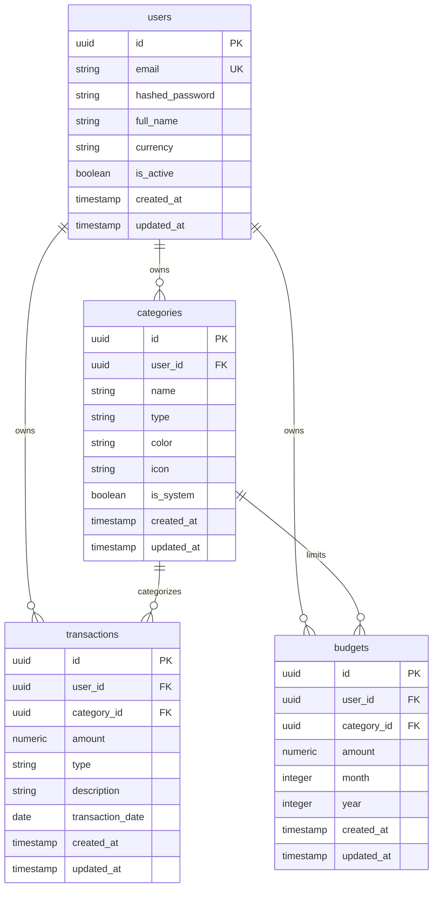

# ExpenseFlow — Personal Finance Management System

<p align="center">
  <b>A Production-Grade Fintech SaaS Platform for Personal Finance, Income & Expense Tracking, Budgeting, and Financial Analytics.</b>
</p>

---

## 🌟 Overview

**ExpenseFlow** is a modern personal finance management application engineered with a clean decoupled architecture:
- **Frontend:** Flutter (Dart 3.9+) with Provider MVVM pattern, GoRouter, fl_chart, and adaptive responsive design for Mobile, Tablet, and Desktop Web.
- **Backend:** Python 3.11+ with FastAPI, Pydantic v2, SQLAlchemy 2.0 ORM, and bcrypt password hashing.
- **Database:** PostgreSQL with UUID primary keys, Decimal precision for all financial calculations, foreign keys, cascade safety, and strict user-level data isolation.
- **DevOps & Deployment:** Docker, Docker Compose, and Nginx reverse proxy.

---

## 🏗️ Architecture

```
ExpenseFlow/
├── backend/
│   ├── app/
│   │   ├── api/
│   │   │   ├── deps.py               # Dependency injection (DB session, JWT auth)
│   │   │   └── v1/
│   │   │       ├── auth.py           # Registration, login, profile, password change
│   │   │       ├── categories.py     # Income & expense category management
│   │   │       ├── transactions.py   # Transaction CRUD with filters & pagination
│   │   │       ├── budgets.py        # Monthly category budgets & utilization
│   │   │       ├── dashboard.py      # Real-time financial statistics & trends
│   │   │       └── reports.py        # Monthly/yearly reports & CSV export
│   │   ├── core/
│   │   │   ├── config.py             # Pydantic BaseSettings environment config
│   │   │   └── security.py           # Bcrypt password hashing & JWT tokens
│   │   ├── database/
│   │   │   └── session.py            # SQLAlchemy engine, sessionmaker, Base
│   │   ├── models/                   # PostgreSQL ORM models
│   │   │   ├── guid.py               # Cross-platform UUID GUID type
│   │   │   ├── user.py               # User credentials & preferences
│   │   │   ├── category.py           # Income & Expense categories
│   │   │   ├── transaction.py        # Transactions with decimal precision
│   │   │   └── budget.py             # Monthly category budget limits
│   │   ├── repositories/             # Database access layer (clean separation)
│   │   ├── schemas/                  # Pydantic request & response validation
│   │   ├── services/                 # Business logic layer
│   │   └── main.py                   # FastAPI application initialization & CORS
│   ├── tests/                        # Pytest suite with 100% test pass rate
│   ├── Dockerfile
│   └── requirements.txt
├── frontend/
│   ├── lib/
│   │   ├── core/
│   │   │   ├── constants/            # API endpoints & fintech color palette
│   │   │   ├── network/              # REST API client with Bearer auth & storage
│   │   │   ├── theme/                # Light & dark theme definitions
│   │   │   └── utils/                # Currency & Date formatters
│   │   ├── models/                   # Dart data models
│   │   ├── repositories/             # Remote API communication
│   │   ├── viewmodels/               # Provider MVVM state management
│   │   ├── views/                    # 10 Responsive screens & dialogs
│   │   └── widgets/                  # Reusable stat cards, charts, tiles
│   ├── Dockerfile
│   └── pubspec.yaml
├── nginx/
│   └── nginx.conf                    # Reverse proxy & SPA routing configuration
├── docker-compose.yml
├── .env.example
└── README.md
```

---

## 📊 Database Schema

Designed for PostgreSQL with UUID primary keys and `Numeric(14, 2)` monetary precision:



---

## 🚀 Key Features

### 1. User Authentication & Profile
- JWT Bearer authentication with configurable token expiry.
- Secure salt-hashed passwords with `bcrypt`.
- Profile editing (Name, preferred display currency: ₹ INR, $ USD, € EUR, £ GBP).
- Secure password change and session invalidation.

### 2. Income & Expense Management
- Real-time income and expense logging with category attribution.
- Date range filtering, category filtering, and live keyword search.
- Paginated transaction records with accurate decimal calculations.

### 3. Financial Dashboard
- Lifetime Net Balance, Total Income, Total Expenses, and Monthly Savings.
- Savings Rate calculation (`(Monthly Savings / Monthly Income) * 100`).
- Interactive 12-month Income vs. Expense trend chart (`fl_chart`).
- Interactive Category-wise expense donut/pie breakdown.
- Budget Exceeded notification banner with instant action.

### 4. Budget Management
- Monthly category budget limits.
- Real-time spent amount, remaining amount, and utilization percentage.
- Exceeded budget warning pill when spending passes 100%.

### 5. In-Depth Reports & CSV Export
- Comprehensive monthly report with daily spending breakdowns and top expenses.
- 12-month yearly financial performance statement.
- RFC 4180 compliant CSV export for transactions with clipboard/download support.

### 6. Premium Fintech UI/UX
- Responsive layouts: Bottom navigation bar for mobile, Navigation rail for tablet/desktop.
- Light and dark themes with persistent user preference.
- Modern fintech emerald and obsidian styling with crisp typography.

---

## ⚡ Quick Start

### Option 1: Docker Compose (Recommended)

1. Clone the repository:
```bash
git clone https://github.com/Maniananthgit/ExpenseFlow.git
cd ExpenseFlow
```

2. Copy the environment variables:
```bash
cp .env.example .env
```

3. Start all services (Database, FastAPI Backend, and Nginx):
```bash
docker compose up -d --build
```

4. Access the applications:
- **Web App:** [http://localhost](http://localhost)
- **API Swagger Documentation:** [http://localhost/docs](http://localhost/docs) or [http://localhost:8000/docs](http://localhost:8000/docs)
- **API Health Check:** [http://localhost:8000/health](http://localhost:8000/health)

---

### Option 2: Running Locally (Development Mode)

#### 1. Backend Setup:
```bash
cd backend
python -m venv venv
# On Windows:
.\venv\Scripts\activate
# On Linux/macOS:
source venv/bin/activate

pip install -r requirements.txt
cp .env.example .env

# Run PostgreSQL database (or configure your connection string in .env)
# Start the FastAPI server:
uvicorn app.main:app --reload --host 127.0.0.1 --port 8000
```

#### 2. Run Backend Tests:
```bash
cd backend
python -m pytest -v
```

#### 3. Frontend Setup:
```bash
cd frontend
flutter pub get
# Run in Chrome (Web) or Desktop:
flutter run -d chrome
```

---

## 🔑 Demo Account

You can log in instantly with the pre-seeded demo user:
- **Email:** `demo@expenseflow.com`
- **Password:** `Password123!`

---

## 🧪 Testing

All critical business logic, security constraints, and data isolation are verified with automated tests:
```bash
cd backend
python -m pytest -v
```
**Test Suites:**
- `test_auth.py`: Registration, Duplicate prevention, Login, Profile updates, Password updates.
- `test_transactions.py`: Income/Expense CRUD, Query filters, Pagination, User data isolation.
- `test_budgets.py`: Budget limits, Spent & remaining computation, 70% utilization, Over-budget detection.
- `test_dashboard.py`: Net balance calculations, Savings rate, Category breakdown, Monthly trends.
- `test_reports.py`: Monthly and Yearly reports, RFC 4180 CSV export.

---

## 📄 License

MIT License. Designed and built for professional software engineering portfolios.
